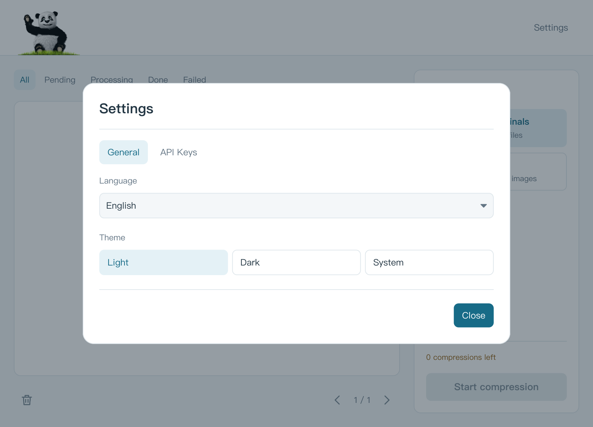

<p align="center">
  
</p>

<h1 align="center">TinyEasy</h1>

<p align="center">A compact desktop app for batch image compression.</p>
<p align="center"><strong>Rust + iced · JPG / PNG / WebP · Light / Dark / System · English / 中文</strong></p>
<p align="center"><strong>English</strong> | <a href="README.zh-CN.md">简体中文</a></p>

TinyEasy brings Tinify image compression into a small desktop workspace: import images, choose where to save them, and follow each file from upload to completion. It supports multiple API Keys, original-image previews, and batch progress without an Electron or Node.js runtime.

**Compression requires an internet connection and your own [Tinify API Key](https://tinify.com/developers). Images are uploaded to Tinify for processing.**


*Light theme, English UI: image cards and status filters on the left, output options and available quota on the right. All screenshots use generated images and simulated task/quota data; the displayed savings are illustrative.*

[Download](#download) · [Features](#features) · [Quick start](#quick-start) · [Screenshots](#screenshots) · [Shortcuts](#shortcuts) · [Build and package](#build-and-package) · [Configuration](#configuration-and-data) · [Contributing](#contributing)

## Download

Download the current release from [GitHub Releases](https://github.com/chaneasy/TinyEasy/releases/latest).

| Platform | Download |
| --- | --- |
| Windows x64 | [Portable EXE](https://github.com/chaneasy/TinyEasy/releases/latest/download/TinyEasy-2.0.0-windows-x86_64.exe) · [ZIP](https://github.com/chaneasy/TinyEasy/releases/latest/download/TinyEasy-2.0.0-windows-x86_64.zip) |
| macOS Apple Silicon | [DMG](https://github.com/chaneasy/TinyEasy/releases/latest/download/TinyEasy-2.0.0-darwin-aarch64.dmg) |
| Linux x64 | [tar.gz](https://github.com/chaneasy/TinyEasy/releases/latest/download/TinyEasy-2.0.0-linux-x86_64.tar.gz) |

Windows: run the EXE directly, or extract the ZIP and run `tinyeasy.exe`. macOS: open the DMG and drag TinyEasy to Applications. The macOS package uses ad-hoc signing and is not notarized.

## Features

| Feature | What you can do |
| --- | --- |
| Batch import | Select JPG/JPEG, PNG, and WebP files, recursively import folders, or drop files and folders into the window. Paths are deduplicated. |
| Image workspace | Browse paginated thumbnails, dimensions, file sizes, and All / Pending / Processing / Done / Failed filters. |
| Original preview | Click a thumbnail to view the original, zoom with the wheel or buttons, drag to pan, and reset the view. |
| Compression queue | Process up to 3 images concurrently, rotate configured Keys, and track per-image and overall progress. Network and image decoding work run in the background. |
| Output choices | Replace originals or save copies to a chosen folder, optionally preserving the folder structure. |
| Results and retry | See original/compressed sizes and space saved; retry failed images while keeping completed results. |
| API Key management | Store up to 50 Keys with optional notes, show/hide values, validate Keys, and view remaining quota and errors. |
| Appearance and language | Switch Light / Dark / System and English / 简体中文 instantly. Preferences persist across restarts. First launch defaults to **System + English**. |

## Quick start

1. Download and launch the [package for your platform](#download), or build using the [instructions below](#build-and-package).
2. Get an API Key from the [Tinify developer page](https://tinify.com/developers). On first launch without a Key, TinyEasy opens **Settings → API Keys**. Add your Key and save; validation runs after saving.
3. Click **Import**, then choose **Images** or **Folder**. You can also drag files/folders into the window. To add more files once the gallery is populated, use drag-and-drop or `Cmd/Ctrl+O`.
4. Choose **Overwrite originals** or **Save a copy** in the Output panel. For copies, choose an output folder and optionally enable **Keep folder structure**.
5. Click **Start compression**. Follow progress, inspect results, and use **Details** to view errors or **Retry** for failed images. Once all images are complete, the start button is disabled until more work is available.

**The default output mode replaces original files.** Choose **Save a copy** to retain them. Replacement happens only after the download succeeds, using a temporary file beside the original; TinyEasy also checks whether the original changed during processing. Copies use names such as `photo.min.png`, then `photo.min-1.png` if needed, without overwriting existing output files.

The current quota model uses a limit of **500 compressions per Key**. Paid-account quota beyond that limit is not currently represented by the app; consult your [Tinify account and API documentation](https://tinify.com/developers/reference/http) for service-side usage.

## Screenshots

### Dark theme and English UI


*Completed image cards show individual results; the Output panel summarizes progress and space saved. This is a simulated completion scene.*

### Theme and language settings



*Settings groups General preferences and API Keys into two tabs. Theme and language changes take effect without restarting or clearing the queue.*

<details>
<summary>Original image preview</summary>


The preview displays the original image and supports wheel zoom, drag-to-pan, zoom buttons, and reset.

</details>

## Shortcuts

Use `Cmd` on macOS and `Ctrl` on Windows/Linux.

| Shortcut | Action |
| --- | --- |
| `Cmd/Ctrl+O` | Import images, including additional images into an existing gallery |
| `Cmd/Ctrl+,` | Open General settings |
| `Cmd/Ctrl+K` | Open API Key settings |
| `Escape` | Close the current dialog or preview, when allowed |
| `Tab` / `Shift+Tab` | Move input focus forward / backward |

## Build and package

### Requirements

- Rust **1.88+** and Cargo. The package is `tinyeasy`; iced is pinned to **0.14.0**, with resolved dependencies in `Cargo.lock`.
- Python **3.9+** for packaging and screenshot scripts.
- A desktop session with native file dialogs. Linux also needs D-Bus / Secret Service for credential storage and a CJK font for Chinese text.

On Ubuntu, install the desktop build dependencies:

```bash
sudo apt-get update
sudo apt-get install libdbus-1-dev libxkbcommon-dev libwayland-dev libx11-dev libxrandr-dev libxi-dev libxcursor-dev libgl1-mesa-dev fonts-noto-cjk
```

Run from the repository root:

```bash
cargo run --release --locked
```

For development, `cargo run --locked` retains debug checks and isolated UI QA hooks. The dev profile also enables optimization to keep software rendering responsive.

### Validation

```bash
cargo fmt --check
cargo clippy --all-targets --all-features --locked -- -D warnings
cargo test --locked
cargo build --release --locked
```

Regular tests use temporary files and mock HTTP services rather than live Tinify requests. Optional system-credential and import-performance tests:

```bash
cargo test --locked native_vault_roundtrip -- --ignored
cargo test --release --locked background_import_benchmark -- --ignored --nocapture
```

The credential test creates and removes a random temporary credential. The import benchmark uses generated images.

### Packaging

Run on the target platform; the script builds the release binary before packaging:

```bash
python3 scripts/package.py
```

| Platform | Output in `release/rust/` | Recorded validation |
| --- | --- | --- |
| macOS | `TinyEasy.app` and `.dmg` | arm64 build and local packaging verified; x86_64 not built |
| Windows | Portable `.exe` and `.zip` | Native build/test/package workflow configured; no executed Windows results recorded |
| Linux | `.tar.gz` | Native build/test/package workflow configured; no executed Linux results recorded |

Each package has a JSON manifest containing exact artifact/binary byte counts and a SHA-256 checksum. Measure package sizes from the artifacts produced by the build you intend to distribute.

macOS packaging currently uses **ad-hoc signing**, without Developer ID signing or notarization. The [GitHub Actions workflow](.github/workflows/rust.yml) runs checks and packages on macOS, Windows, and Ubuntu, then uploads workflow artifacts. Pushing a version tag such as `v2.0.0` also publishes the EXE, ZIP, DMG, Linux archive, and checksum manifests to GitHub Releases after all platform checks pass.

**Platform limitations:** iced 0.14 does not provide native file-drop events on Wayland. Use Import for the initial batch and `Ctrl+O` to add images afterward. X11/native drag-and-drop still needs platform verification. Native screen-reader accessibility also requires further work and validation.

## Configuration and data

### API Keys

Keys and notes are encrypted locally with **ChaCha20-Poly1305**. A randomly generated master key is stored in macOS Keychain, Windows Credential Manager, or Linux Secret Service. Theme and language are stored separately; ordinary preferences contain no plaintext API Keys. Key edits are disabled while compression is running.

When no local or legacy Key configuration exists, TinyEasy can load `TINIFY_API_KEYS` (comma, semicolon, or whitespace separated) and `TINIFY_API_KEY` from the environment. Saved local configuration takes priority, including a saved empty Key list. Keep actual credentials out of source code, logs, screenshots, and issue reports.

### Storage locations

The directory follows system conventions through `directories::ProjectDirs`. Default locations are:

| Platform | Configuration directory |
| --- | --- |
| macOS | `~/Library/Application Support/com.TinyEasy.TinyEasy/` |
| Windows | `%APPDATA%\TinyEasy\TinyEasy\config\` |
| Linux | `~/.config/tinyeasy/` (or the configured XDG location) |

`settings.json` stores version, theme, and language; `keys.enc` stores encrypted Keys and notes. Corrupt preference files are kept rather than silently overwritten; explicit repair of corrupt Key ciphertext retains a recovery copy. If an old Electron `tinify-keys.json` is found, it is preserved and you are prompted to re-enter Keys; Rust does not directly decrypt Electron `safeStorage` data.

### Isolated UI screenshots

With a desktop display available, render generated scenes without loading user credentials or contacting Tinify:

```bash
python3 scripts/render-ui.py
python3 scripts/render-ui.py --docs
```

Generated QA screenshots go to `docs/ui-screenshots/`, which is ignored by Git and excluded from packages. Public README images live in `docs/images/`; regenerate them with `--docs` to keep the UI and sample filenames in English in both README languages. Debug builds support `TINYEASY_QA_DIR` for an isolated preference directory, `TINYEASY_QA_SCENE` (for example `settings`, `keys-many`, `preview`), `TINYEASY_QA_IMPORT` for generated/copied images, and `TINYEASY_QA_SMALL=1` for a small window. The QA entry points are removed from release builds. Use temporary directories and image copies when testing.

## Contributing

Bug reports, translations, UI improvements, and platform validation are welcome. Include your OS/architecture, TinyEasy version, and reproduction steps in an issue. For UI changes, include screenshots in both languages and light/dark themes; for code changes, run the validation commands above. Never attach API Keys or private images.

Application code lives in `rust/`, shared brand resources in `assets/`, app icons in `assets/app-icons/`, and build/QA tools in `scripts/`.

The Cargo package declares the MIT license in [Cargo.toml](Cargo.toml).
