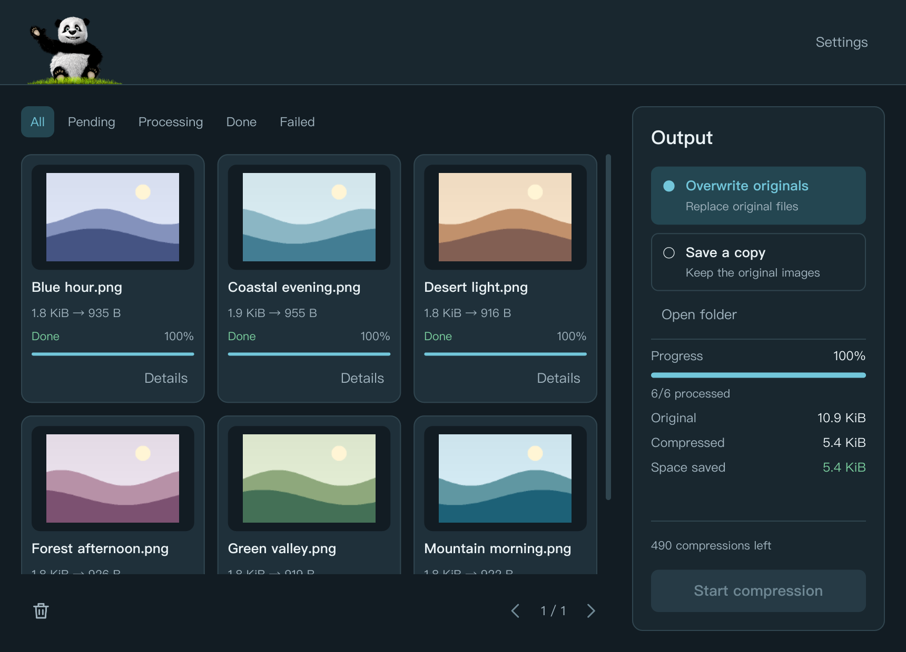
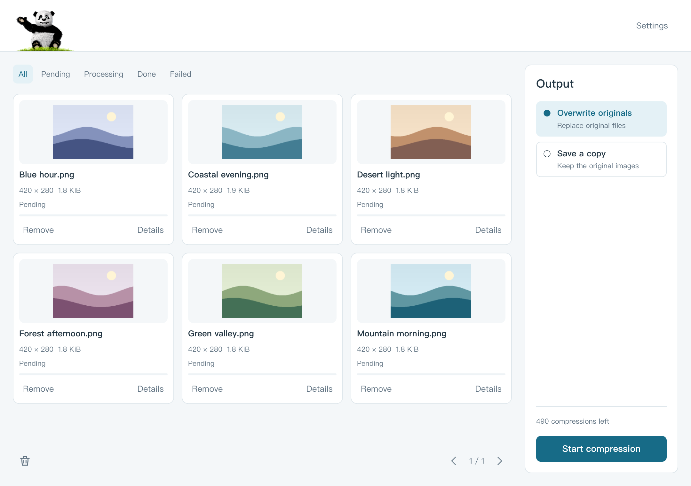
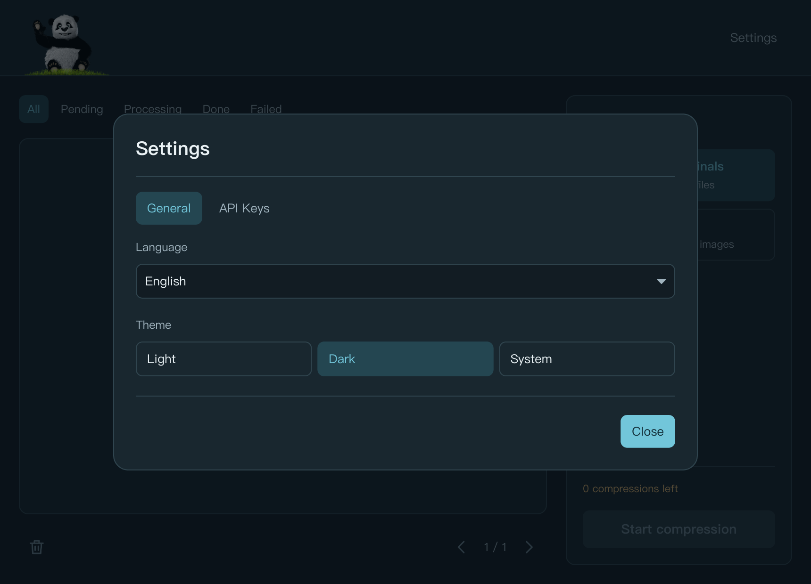
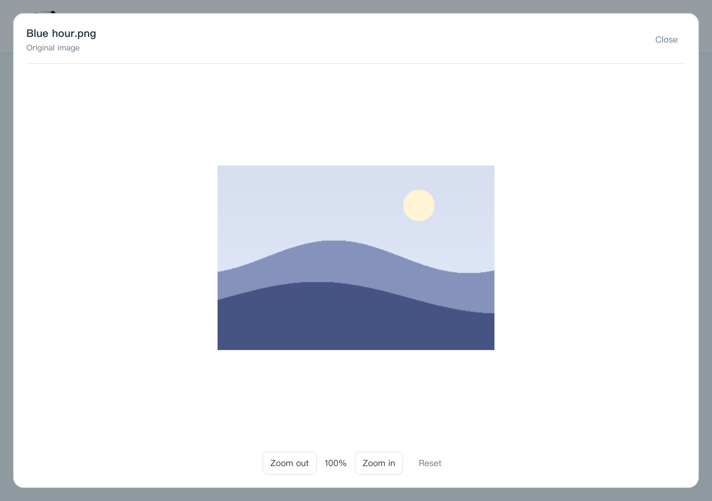

<p align="center">
  
</p>

<h1 align="center">TinyEasy</h1>

<p align="center">简洁紧凑的桌面图片批量压缩工具。</p>
<p align="center"><strong>Rust + iced · JPG / PNG / WebP · 浅色 / 深色 / 跟随系统 · English / 中文</strong></p>
<p align="center"><a href="README.md">English</a> | <strong>简体中文</strong></p>

TinyEasy 将 Tinify 图片压缩服务整合进一个紧凑的桌面工作区：导入图片、选择保存方式、查看每张图片的处理进度与结果。支持多个 API Key、原图预览和批量任务统计，应用运行无需 Electron 或 Node.js。

**压缩需要联网，并使用你自己的 [Tinify API Key](https://tinify.com/developers)。图片会上传至 Tinify 服务进行处理。**



*深色主题、英文界面：左侧查看图片和状态，右侧选择输出方式、查看进度及节省空间。本文截图使用生成图片和模拟任务、额度数据，压缩结果仅用于界面演示。*

[下载](#下载) · [功能亮点](#功能亮点) · [快速上手](#快速上手) · [界面展示](#界面展示) · [快捷键](#快捷键) · [构建与打包](#构建与打包) · [配置与数据](#配置与数据) · [参与贡献](#参与贡献)

## 下载

从 [GitHub Releases](https://github.com/chaneasy/TinyEasy/releases/latest) 下载当前版本。

| 平台 | 下载 |
| --- | --- |
| Windows x64 | [便携 EXE](https://github.com/chaneasy/TinyEasy/releases/latest/download/TinyEasy-2.0.0-windows-x86_64.exe) · [ZIP](https://github.com/chaneasy/TinyEasy/releases/latest/download/TinyEasy-2.0.0-windows-x86_64.zip) |
| macOS Apple Silicon | [DMG](https://github.com/chaneasy/TinyEasy/releases/latest/download/TinyEasy-2.0.0-darwin-aarch64.dmg) |
| Linux x64 | [tar.gz](https://github.com/chaneasy/TinyEasy/releases/latest/download/TinyEasy-2.0.0-linux-x86_64.tar.gz) |

Windows 可直接运行 EXE，或解压 ZIP 后运行 `tinyeasy.exe`。macOS 打开 DMG，将 TinyEasy 拖入 Applications。macOS 包使用 ad-hoc 签名，尚未公证。

## 功能亮点

| 功能 | 说明 |
| --- | --- |
| 批量导入 | 支持 JPG/JPEG、PNG、WebP；选择多个文件、递归导入文件夹，或拖入图片和文件夹，按路径去重。 |
| 图片工作区 | 分页浏览缩略图、图片尺寸与文件大小，按全部 / 待处理 / 处理中 / 完成 / 失败筛选。 |
| 原图预览 | 点击缩略图查看原图，支持滚轮与按钮缩放、拖动平移、重置视图。 |
| 压缩队列 | 最多同时处理 3 张图片，轮换已配置的 Key，显示单图及整体进度；网络请求和图片解码在后台执行。 |
| 灵活输出 | 覆盖原图或另存到指定文件夹，另存时可保留文件夹结构。 |
| 结果与重试 | 查看压缩前后大小及节省空间，单独重试失败图片，保留已完成结果。 |
| API Key 管理 | 最多保存 50 个 Key，支持备注、遮罩 / 查看、校验、剩余额度与错误查看。 |
| 主题与语言 | 浅色 / 深色 / 跟随系统，English / 简体中文即时切换，重启恢复偏好；首次启动默认 **跟随系统 + English**。 |

## 快速上手

1. 下载并启动[对应平台的应用包](#下载)，也可以按[下方说明](#构建与打包)从源码构建运行。
2. 前往 [Tinify 开发者页面](https://tinify.com/developers)获取 API Key。首次启动无 Key 时，应用自动打开 **Settings → API Keys**；添加 Key 并保存，保存后自动校验。
3. 点击 **Import / 导入**，选择 **Images / 图片** 或 **Folder / 文件夹**，也可将文件或文件夹拖入窗口。列表已有图片后，可通过拖放或 `Cmd/Ctrl+O` 继续添加图片。
4. 在右侧输出栏选择 **覆盖原图** 或 **另存到文件夹**；另存时选择输出目录，可勾选 **保留文件夹结构**。
5. 点击 **开始压缩**，查看进度和结果。失败时点击 **详情** 查看原因，使用 **重试** 重新处理。全部完成后，开始按钮会置灰，直到新增图片或存在需要重试的任务。

**默认保存方式会替换原图。** 如需保留原始图片，请选择 **另存到文件夹**。覆盖模式先下载至原图旁的临时文件，下载成功后再替换，并检查原图在处理期间是否发生变化。另存文件使用 `photo.min.png` 等名称；遇到重名自动使用 `photo.min-1.png`，不会覆盖已有输出文件。

当前应用按 **每个 Key 500 次**计算可用额度，暂未适配超过该上限的付费账户额度；服务端实际使用情况请以 [Tinify 账户和 API 文档](https://tinify.com/developers/reference/http)为准。

## 界面展示

### 浅色主题与英文界面



*紧凑的图片卡片显示文件名、尺寸、大小和处理状态；输出选项与可用额度集中在右侧。*

### 主题与语言设置



*设置分为常规和 API Key 两个页签。主题和语言切换立即生效，无需重启，不会清空队列。*

<details>
<summary>原图预览</summary>



预览显示原始图片，支持滚轮缩放、拖动平移、缩放按钮及重置。

</details>

## 快捷键

macOS 使用 `Cmd`，Windows / Linux 使用 `Ctrl`。

| 快捷键 | 操作 |
| --- | --- |
| `Cmd/Ctrl+O` | 导入图片，也可向已有列表继续添加图片 |
| `Cmd/Ctrl+,` | 打开常规设置 |
| `Cmd/Ctrl+K` | 打开 API Key 设置 |
| `Escape` | 在允许关闭时退出当前弹窗或预览 |
| `Tab` / `Shift+Tab` | 向前 / 向后切换输入焦点 |

## 构建与打包

### 环境要求

- Rust **1.88+** 和 Cargo。包名为 `tinyeasy`，iced 固定为 **0.14.0**，依赖解析由 `Cargo.lock` 锁定。
- 打包与截图脚本需要 Python **3.9+**。
- 提供原生文件选择器的桌面环境。Linux 还需要 D-Bus / Secret Service 保存凭据，以及中文字体。

Ubuntu 桌面构建依赖：

```bash
sudo apt-get update
sudo apt-get install libdbus-1-dev libxkbcommon-dev libwayland-dev libx11-dev libxrandr-dev libxi-dev libxcursor-dev libgl1-mesa-dev fonts-noto-cjk
```

在项目根目录运行：

```bash
cargo run --release --locked
```

开发时可使用 `cargo run --locked`，保留调试检查和隔离 UI QA 入口。dev 配置也启用优化，保证软件渲染的响应速度。

### 验证

```bash
cargo fmt --check
cargo clippy --all-targets --all-features --locked -- -D warnings
cargo test --locked
cargo build --release --locked
```

常规测试使用临时文件和模拟 HTTP 服务，不调用真实 Tinify。系统凭据存储和导入性能专项可单独运行：

```bash
cargo test --locked native_vault_roundtrip -- --ignored
cargo test --release --locked background_import_benchmark -- --ignored --nocapture
```

凭据专项只创建并清理随机临时凭据，导入性能测试使用生成图片。

### 打包

在对应目标平台执行，脚本会先构建 release 程序：

```bash
python3 scripts/package.py
```

| 平台 | `release/rust/` 下的产物 | 已记录的验证情况 |
| --- | --- | --- |
| macOS | `TinyEasy.app` 和 `.dmg` | arm64 构建及本地打包已验证；x86_64 未构建 |
| Windows | 便携 `.exe` 和 `.zip` | 已配置原生构建、测试、打包工作流；尚无实际执行结果记录 |
| Linux | `.tar.gz` | 已配置原生构建、测试、打包工作流；尚无实际执行结果记录 |

每个安装包同时生成 JSON 清单，包含包体与二进制的精确字节数，以及 SHA-256 校验值。包体大小应从本次准备发布的实际构建产物测量。

macOS 当前仅使用 **ad-hoc 签名**，未使用 Developer ID 签名或公证。[GitHub Actions 工作流](.github/workflows/rust.yml)在 macOS、Windows、Ubuntu 上运行检查、打包并上传工作流产物。推送 `v2.0.0` 等版本标签后，全部平台检查通过时自动发布 EXE、ZIP、DMG、Linux 压缩包及校验清单到 GitHub Releases。

**平台限制：** iced 0.14 在 Wayland 下尚不提供原生文件拖放事件。首次导入使用导入按钮，列表已有图片后使用 `Ctrl+O` 继续添加。X11 等平台的原生拖放仍需验证，原生读屏可访问性也需要进一步完善与验收。

## 配置与数据

### API Key

Key 与备注使用 **ChaCha20-Poly1305** 本地加密保存，随机生成的主密钥存入 macOS Keychain、Windows Credential Manager 或 Linux Secret Service。主题和语言单独保存，普通偏好文件不包含明文 API Key。压缩期间禁止编辑 Key。

当不存在本地或旧版 Key 配置时，可从环境变量 `TINIFY_API_KEYS`（逗号、分号或空白分隔）和 `TINIFY_API_KEY` 加载 Key。本地已保存配置优先，包括显式保存的空 Key 列表。请勿将真实凭据写入源码、日志、截图或问题反馈。

### 存储位置

配置目录由 `directories::ProjectDirs` 按系统规则确定，默认路径为：

| 平台 | 配置目录 |
| --- | --- |
| macOS | `~/Library/Application Support/com.TinyEasy.TinyEasy/` |
| Windows | `%APPDATA%\TinyEasy\TinyEasy\config\` |
| Linux | `~/.config/tinyeasy/`，或系统设置的 XDG 目录 |

`settings.json` 保存版本、主题和语言，`keys.enc` 保存加密 Key 与备注。损坏的偏好文件不会被静默覆盖；显式修复损坏的 Key 密文前会保留恢复副本。检测到旧 Electron `tinify-keys.json` 时会保留原文件并提示重新输入 Key，不会直接解密 Electron `safeStorage` 数据。

### 隔离 UI 截图

在具有桌面显示的环境中，可渲染生成的测试场景，不加载用户凭据、不访问 Tinify：

```bash
python3 scripts/render-ui.py
python3 scripts/render-ui.py --docs
```

生成的 QA 截图保存至 `docs/ui-screenshots/`，由 Git 忽略，也不包含在发行包中。README 展示图片位于 `docs/images/`；使用 `--docs` 重新生成，中英文文档均使用英文界面及英文示例文件名。调试构建支持 `TINYEASY_QA_DIR` 指定隔离偏好目录，`TINYEASY_QA_SCENE` 选择场景（如 `settings`、`keys-many`、`preview`），`TINYEASY_QA_IMPORT` 指定生成图片或图片副本目录，`TINYEASY_QA_SMALL=1` 使用小窗口。release 构建移除 QA 入口；测试请使用临时目录和图片副本。

## 参与贡献

欢迎提交问题反馈、翻译改进、界面优化和平台验证。反馈时请提供操作系统与架构、TinyEasy 版本及复现步骤；界面改动请附上中英文、浅深色截图，代码改动请运行上方验证命令。不要附带 API Key 或私人图片。

应用代码位于 `rust/`，共享品牌资源位于 `assets/`，应用图标位于 `assets/app-icons/`，构建与 QA 工具位于 `scripts/`。

[Cargo.toml](Cargo.toml) 中的 Cargo 包许可证声明为 MIT。
